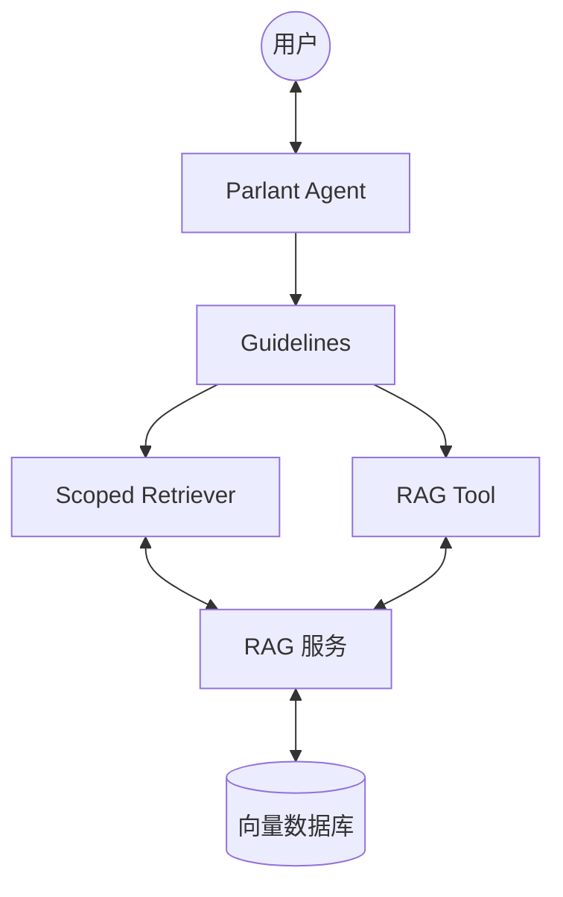

**基于 Parlant 框架的「极简版」RAG 实现方案**

### 极简架构图回顾



---

### **模块解释一览表**

| 模块 | 名称 | 简要说明 | 示例 |
|------|------|----------|------|
| **User** | 用户 | 发起提问并接收回答的真实用户 | 用户在聊天框输入："30天能退货吗？" |
| **Agent** | Parlant Agent | **整个系统的"大脑"**，负责接收消息、协调逻辑、生成最终回复 | Parlant 中通过 `create_agent()` 创建的智能客服助手 |
| **GL** | Guidelines | **规则/准则**，用自然语言定义"在什么情况下该做什么" | `condition="当用户询问退货政策、会员权益时"`<br>`action="去检索知识库后回答"` |
| **SR** | Scoped Retriever | **推荐主力**的 RAG 实现方式。绑定在 Guideline 上，**自动**检索相关知识 | 用户问退货政策时，自动调用 RAG 检索相关文档并注入上下文 |
| **Tool** | RAG Tool | **辅助方式**。需要 Agent 主动调用的检索工具，控制更精准 | `@p.tool` 定义的 `search_knowledge()` 函数，用户明确说"帮我查最新政策文档"时才调用 |
| **RAG** | RAG 服务 / Pipeline | 你自己实现的**检索管道**，负责 Embedding、向量搜索、排序等操作 | 使用 LlamaIndex 或 LangChain 编写的检索流程，接收问题后返回最相关文档 |
| **VDB** | 向量数据库 | 实际存储公司知识文档的地方 | Milvus / PGVector / Chroma 中存储的数百篇公司政策、产品手册、FAQ 文档 |

---

### RAG 实现方式（RAGMode）

`plan_a` 通过 `RAGMode` 枚举提供两种 RAG 模式：

#### `RAGMode.STANDALONE`（独立模式）

不依赖 Parlant 框架，直接使用 `RAGPipeline` 进行向量检索，再调用 `LLMClient` 生成回答。适合脚本测试、批量评估等轻量场景，**无需安装 parlant / torch**。

```
用户查询
    │
    ▼ RAGPipeline.retrieve_standard()
List[DocChunk]
    │
    ▼ LLMClient.chat_async()
回答文本
```

#### `RAGMode.PARLANT`（Parlant 集成模式）

通过 Parlant 的 `@p.tool` 接口检索，后台程序化执行，**不启动 Server / 不弹出 UI**。
所有逻辑封装在 `plan_a/runner.py` 的 `run_parlant()`，测试脚本只调用该函数。

```
run_parlant(pipeline, queries, llm)
    │
    ▼ make_rag_tool(pipeline)(None, query)   ← @p.tool 接口，无需 Server
    ToolResult（chunks + formatted context）
    │
    ▼ LLMClient.chat_async()
    回答文本
```

对应入口：`examples/05_plan_a_agent.py --mode parlant`

#### Parlant Server 模式（完整 Agent 部署）

需要 Parlant Server 时（生产部署 / 完整集成测试），使用 `run_parlant_server()`：
启动 `p.Server(nlp_service=p.NLPServices.litellm)`（NLP 模型来自 `.env`），
创建 Agent + Guidelines，后台程序化执行 query-answer，**不弹出 UI**。

```
p.Server(nlp_service=p.NLPServices.litellm)
    │
    ├── Agent.create_guideline → SR[Scoped Retriever]（主力，自动触发）
    │       └── RAGPipeline.retrieve_standard()
    └── Agent.create_guideline → Tool[RAG Tool]（辅助，程序化调用）
            └── RAGPipeline.retrieve_standard()
```

对应入口：`examples/06_rag_query.py`

---

### 模块之间的关系简述

- **用户** 与 **Agent** 双向交互（问答）
- **Agent** 依赖 **Guidelines** 来判断当前对话该怎么处理
- **Guidelines** 可以同时触发两种知识获取方式：
  - **Scoped Retriever**（主力，自动、并行、高效）
  - **RAG Tool**（辅助，手动控制更强）
- 两种方式最终都调用 **RAG 服务** 去向量数据库中查找最相关的内容
- **RAG 服务** 处理完后把知识返回给 Parlant，由 Agent 生成最终回复

---

### 总结（一句话理解）

- **Parlant Agent** 是"大脑"
- **Guidelines** 是"决策规则"
- **Scoped Retriever** 是"自动查资料的主要方式"
- **RAG 服务 + 向量数据库** 是"真正的知识仓库"
